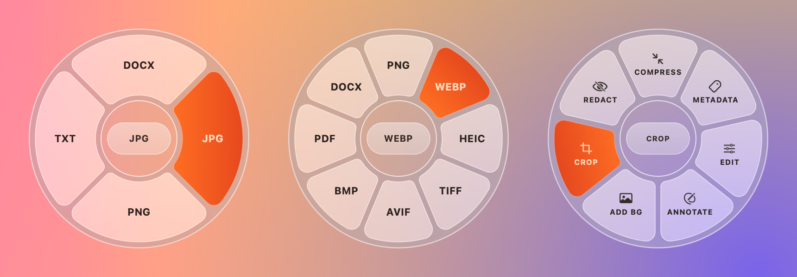
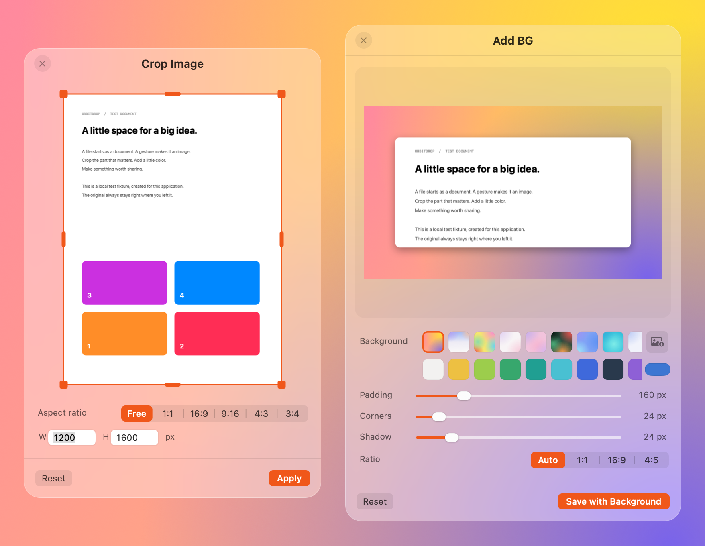
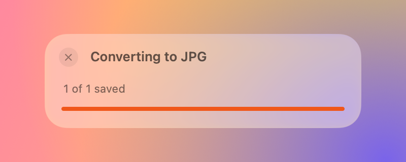

<div align="center">

# OrbitDrop

**Drag a file, pause, drop it on a wheel.** Convert, crop and restyle images and PDFs without opening an app.

[**Download for Mac**](https://www.felixlaga.com/downloads/OrbitDrop-1.1.0-AppleSilicon.dmg) · Apple Silicon · macOS 13 or later




</div>

## How it works

1. Start dragging an image or PDF in Finder.
2. Hold still for a moment. The wheel opens around your pointer.
3. Drop the file on a wedge.

A drag that keeps moving never opens the wheel, so normal Finder moves work as before. The new file is saved next to the original, which stays untouched.

## What it does

**Convert.** PDFs go to DOCX, JPG, PNG or TXT. Images go to PNG, WEBP, HEIC, TIFF, AVIF, BMP, PDF or DOCX. A small card at the drop point shows the progress.

**Tools.** Press **⌥ Option** while dragging to switch to the tools wheel. Press it again to switch back.

| Tool | What it does |
| --- | --- |
| Crop | Drag the handles or pick a ratio: Free, 1:1, 16:9, 9:16, 4:3, 3:4 |
| Add BG | Puts the image on a gradient, colour or photo, with padding, rounded corners and a shadow |
| Edit | Brightness, contrast, saturation, rotate and flip |
| Annotate | Pen, rectangle, arrow and text |
| Redact | Covers areas with solid pixels that can't be undone |
| Compress | Saves a smaller copy at the quality you choose |
| Metadata | Shows the file's metadata and saves a copy without it |



<p align="center"></p>

## Install

1. Open `OrbitDrop.dmg` and drag **OrbitDrop** into **Applications**.
2. Open OrbitDrop from Applications. A small circle icon appears in the menu bar. There is no Dock icon.

### When macOS blocks the first launch

This build is signed on my Mac but not notarized by Apple. So the first time you open it, macOS shows a warning. To allow it:

1. Open OrbitDrop once. When the warning appears, click **Done**.
2. Open **System Settings → Privacy & Security**.
3. Scroll down to the **Security** section. You'll see "OrbitDrop was blocked to protect your Mac".
4. Click **Open Anyway**, enter your password, then click **Open**.

You only do this once. Look in the Security section, not the permission lists above it: OrbitDrop doesn't appear there. Apple describes these steps in [Safely open apps on your Mac](https://support.apple.com/en-us/102445).

## Settings

Click the menu-bar icon for these options:

- **Open File…** (⌘O) opens the wheel for a file you pick, without dragging.
- **Show Wheel** opens the wheel for the last file. **⌃⌥Space** does the same from anywhere.
- **Show When Dragging Files** turns the drag wheel on or off.
- **Open at Login** starts OrbitDrop when you log in. It then also appears in **System Settings → General → Login Items**.
- **Quit OrbitDrop** closes it.

In the wheel, click the centre to switch between formats and tools, drag the centre to move the wheel, and press Escape to close it.

## Privacy

- **Everything stays on your Mac.** OrbitDrop makes no network connections and has no analytics or accounts.
- **No special permissions.** It never asks for Accessibility or Screen Recording. It reads only the files you drop on it or open with it.
- **Folder access.** macOS may ask once whether OrbitDrop can use files in Desktop, Documents or Downloads, because it saves results next to the original. Click **Allow**. You can change this later in **System Settings → Privacy & Security → Files & Folders**.
- **Originals are never changed.** Results are new files beside the original, with a number added if a name is taken.

## Build from source

You need Apple's Command Line Tools. No package manager is needed.

```sh
bash test.sh      # offline tests; opens no windows
bash build.sh     # builds build/OrbitDrop.app
bash package.sh   # builds dist/OrbitDrop.dmg, a zip and checksums
```

The app is Swift with AppKit, Core Graphics, ImageIO, PDFKit, Vision and Core Image. WebP and AVIF encoders are bundled with their licences. On macOS 26 the wheel, editors and progress card use Liquid Glass; older systems get a shaped blur. See [`VALIDATION.md`](VALIDATION.md) for what was tested and its limits.

## Background

OrbitDrop recreates a Mac app shown in a short screen recording. Sizes, colours and timing were measured from that video: the wheel is 238 pt across, the Crop window 370 × 560 pt and Add BG 418 × 618 pt. The video doesn't show how the original switches to tools, or the Edit, Annotate, Redact, Compress and Metadata screens, so those follow the same style. It's an independent recreation, not the original app.
